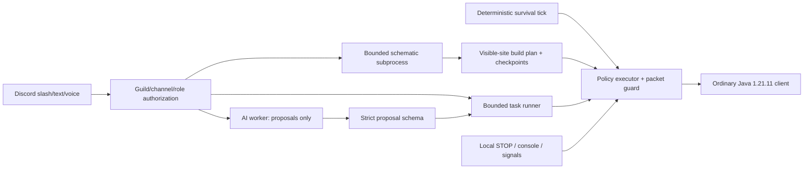

# Architecture and trust boundaries

Survival ticks every 50 ms and never await AI, Discord, speech or build-planning network requests. Close hostiles, low health, creepers, lava/fire, low oxygen, food, armor and bounded recovery have deterministic priorities. Maintenance scans run at most every 750 ms and inspect only blocks whose line of sight is verified. Known client terrain is used for ordinary pathfinding; resource selection/planner observations never expose blocks occluded by terrain. World chat, sign text, inventory display names, container text and schematic metadata are never instructions to the planner.

The planner has a separate worker thread with a bounded heap, request concurrency, response size and deadlines. It receives canonical positions/registry names and inventory counts, not credentials, policy mutators, OP commands or unrestricted tools. A strict discriminated schema allows only status/stay/move/mine/craft proposals. Conversation cannot execute mining, even if a model proposes it: demolition requires `/mine`. Schematic construction requires `/build` and a builder role. Prompt injection cannot grant permission, change policy, invent an executor action, supply another actor, or gain filesystem/process access. This architecture limits model authority; it does not claim that language models can perfectly identify all malicious text or always choose good allowed tasks.

The executor serializes authorized operations. Higher-priority survival work preempts normal tasks; cancellation invalidates the generation and aborts waiting promptly. Async-local action contexts propagate into Mineflayer library calls. The outbound packet guard denies controlled interaction/inventory/combat/respawn/chat packets outside an authorized current context, including late writes from cancelled calls. Cleanup packets to stop digging/release item use remain permitted. Movement uses a conservative pathfinder with automatic digging, scaffolding, towers, sprinting, parkour, doors and long drops disabled. Its search yields in 5 ms slices with a bounded total budget. Leaving a configured area latches stop. No packet manipulation tries to bypass survival rules or anti-cheat checks.

Minecraft actions validate dimension, area and principal again immediately before dispatch. Mining uses ordinary tool selection and Mineflayer dig timing, forbids mining underfoot/known falling hazards and protected containers, and verifies block removal. Placement requires empty target space, inventory, a visible reachable supported face and server-confirmed block updates; only implemented full-block placements are accepted. Defensive melee requires a visible close hostile and an item-specific 1.21.11 attack cooldown. Players cannot be targeted. Server responses remain authoritative.

Schematic parsing uses a pure custom bounded NBT reader in a separate permission-restricted Node subprocess (64 MiB V8 heap, 2.5 s deadline, 2 MiB input, 8 MiB inflated data, depth/count/volume limits). Filesystem reads are limited to the parser and placement whitelist; environment is empty. Input supplies no executable code or paths. The Node permission model is an additional boundary, not a replacement for OS isolation against arbitrary native code. The parser has no network/process/eval API use. A hardened deployment can additionally run the entire bot/container with restricted egress and OS resource limits.

Build planning refuses unknown/occluded sites, conflicts, unsupported block states, and unbounded supports. It creates a deterministic placement order, retains temporary cobblestone supports, counts only needed materials, and checks policy for all placements. Checkpoints are written atomically after server-confirmed changes and keyed by schematic hash/origin/dimension. Re-running `/build` after re-upload/restart revalidates the actual visible world and omits already correct blocks; completion flags alone never authorize skipping verification. Support records survive resuming. Checkpoint identity includes the Minecraft version; parsed format/data versions must match the target before any build planning. No implicit demolition or cleanup is performed.

Audit records contain event types, actor IDs, action kinds, bounded positions and checkpoint hashes. They deliberately exclude raw chat/audio, tokens, service payloads and raw errors. Records are hash chained within sessions; this is local integrity evidence, not a cryptographically authenticated remote log. Protect audit/checkpoint/auth directories; collect audit remotely if stronger tamper resistance or retention is needed.
